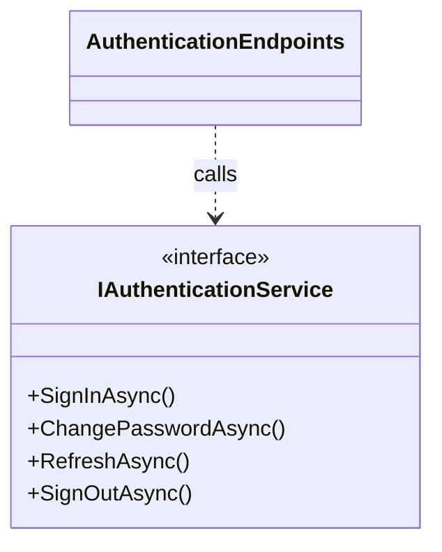
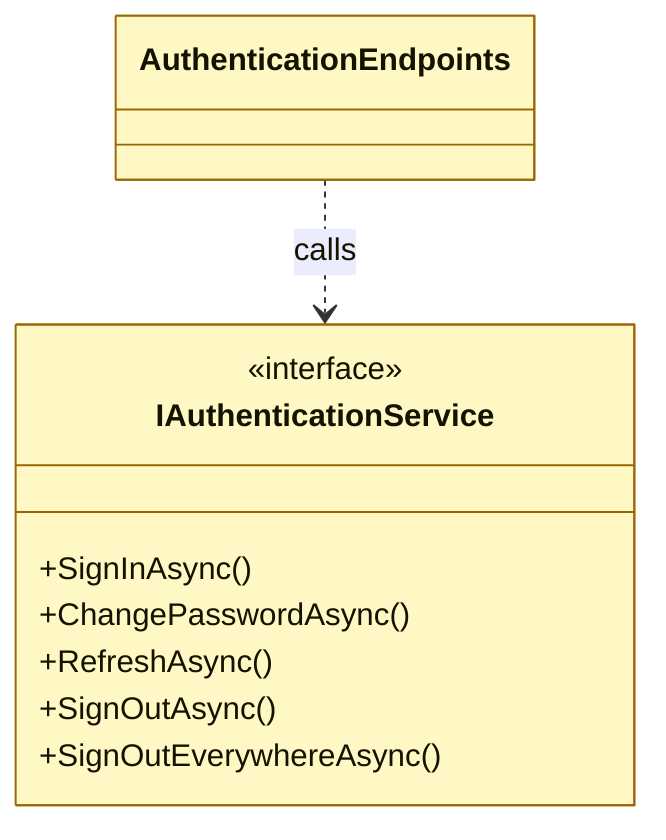

# Architecture delta template

The `## Architecture delta` section of a spec or ticket issue, and the body of a non-interactive proposal comment. Copy the template, fill every section (write `None` rather than deleting one), and make it self-contained: an implementer applies it to the slices without this conversation.

## Filling rules

- **Status.** A proposal carries `Status: Proposed — awaiting approval`. Only after the user explicitly approved this exact delta (SKILL.md step 5) does it become `Status: Approved` followed by `Approved by @<user> on <YYYY-MM-DD>`. Any later edit returns it to `Proposed`.
- **Placement.** In a spec issue, put the section after `## Implementation Decisions`; in a ticket, after `## Acceptance criteria`. When `to-tickets` splits the work, each ticket that changes architecture holds its own section covering exactly what it builds, its Before equal to its predecessor's After, and the spec links to them. Slice pointers `> Pending approved changes: #N` name the issue holding the approved section.
- **Links.** Issue bodies do not resolve relative paths: link slices as `https://github.com/FlorianAlbert/ChronicleOfHeros/blob/main/docs/architecture/<path>.md`.
- **Before** is the slice's current block, copied verbatim (including any `%% verify:` line), so the implementer can match it against the slice.
- **After** is the drafted block, marked with the `added`, `removed` (still drawn), and `changed` classDefs copied from `docs/architecture/conventions.md`. The implementing PR strips them when it moves After into the slice.
- **Inventory tables** (endpoints, Aspire resources and parameters, DbContext entity sets) use one diff table: a leading `Change` column (`added` / `removed` / `changed`) plus the view's own columns, affected rows only, `old → new` in each changed cell. Cell values use the view's own vocabulary exactly as conventions.md specifies (for example `Policy:Player`, not prose), so they copy verbatim into the verified view.
- **One `####` block per affected view**, ordered by slice path. Diagrams follow the verified-view parseability rules: one relationship per line, no chaining or `&`, simple node ids with the full name in `["label"]`.

## Template

````markdown
## Architecture delta

Status: Proposed — awaiting approval

### Summary

<What changes architecturally and why: the motivation, in 1–3 sentences.>

### Affected slices

- [`docs/architecture/<area>/<view>.md`](https://github.com/FlorianAlbert/ChronicleOfHeros/blob/main/docs/architecture/<area>/<view>.md): <what changes in it>

### Views

#### `<area>/<view>.md`: <view name>

**Before**

```mermaid
<current block, verbatim from the slice>
```

**After**

```mermaid
<target block with added / removed / changed marks>
```

#### `<area>/<view>.md`: <inventory view name>

| Change | <view column 1> | <view column 2> |
| --- | --- | --- |
| added | … | … |

### Decisions and alternatives considered

- **<Decision>**: <why>. Rejected: <alternative>, because <reason>.

### ADRs and standards

- ADRs: <None | new ADR-NNNN "<title>" (hard to reverse because …) | ADR-NNNN content change … | status change to `Status: …`>
- `CODING_STANDARDS.md`: <None | rule added or changed …>

### Verified views and tests

- Verified views: <view ids, e.g. `api-endpoints` | None>
- Architecture tests: <new or changed tests and allowlists | None: existing conformance tests cover it>
````

## Example (illustrative; slice paths and highlight colours depend on `docs/architecture/conventions.md`)

````markdown
## Architecture delta

Status: Proposed — awaiting approval

### Summary

Players can sign out on every device at once. `IAuthenticationService` gains `SignOutEverywhereAsync`, exposed by a new API endpoint, so a lost device can be locked out without a password change.

### Affected slices

- [`docs/architecture/capabilities/identity/classes.md`](https://github.com/FlorianAlbert/ChronicleOfHeros/blob/main/docs/architecture/capabilities/identity/classes.md): new contract operation
- [`docs/architecture/hosts/api.md`](https://github.com/FlorianAlbert/ChronicleOfHeros/blob/main/docs/architecture/hosts/api.md): new endpoint

### Views

#### `capabilities/identity/classes.md`: contract and endpoint adapter

**Before**



**After**



#### `hosts/api.md`: API endpoints

| Change | Method | Route | Adapter | Authorization |
| --- | --- | --- | --- | --- |
| added | POST | /authentication/sign-out-everywhere | AuthenticationEndpoints | Policy:Player |

### Decisions and alternatives considered

- **Revoke every refresh token of the account inside the Identity capability**: token lifetime stays owned by Identity. Rejected: clearing only the Web session cookie, because other devices keep valid refresh tokens.

### ADRs and standards

- ADRs: None
- `CODING_STANDARDS.md`: None

### Verified views and tests

- Verified views: `api-endpoints`
- Architecture tests: None: existing conformance tests cover it
````
