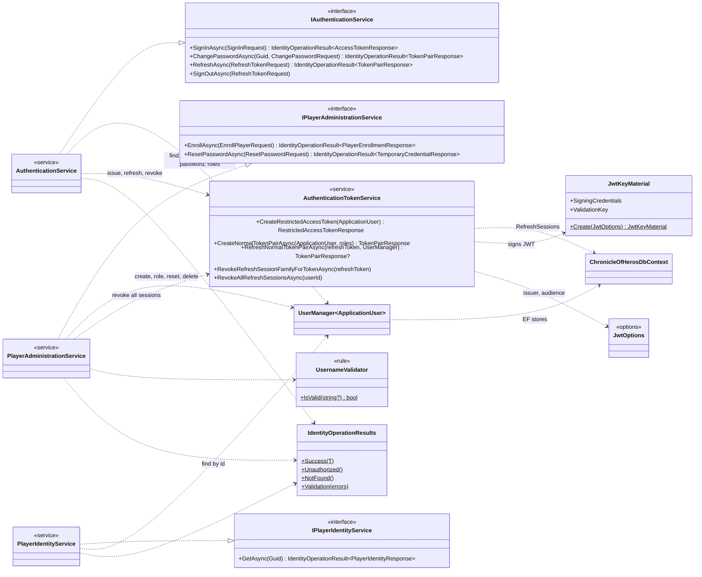
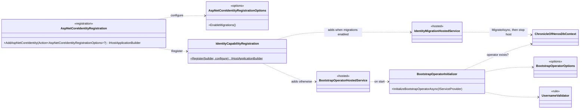

# Identity: classes

Scope: the Identity types that collaborate at runtime: contract interfaces, services, token handling, persistence entry points, registration, and hosted services.
Load when: changing an Identity contract operation, service, token or refresh-session handling, registration, or hosted service.
Parent: [index.md](index.md) · Neighbours: [components.md](components.md), [domain.md](domain.md), [persistence.md](persistence.md), [state.md](state.md)

> Pending approved changes: #75

## Contract services

- The services return `IdentityOperationResult<T>`: a value, or an `IdentityFailure` of kind `Unauthorized`, `NotFound`, or `Validation` (with errors keyed by field or Identity error code). `SignOutAsync` returns nothing.
- `AuthenticationTokenService` has no interface; both services depend on the class. It holds the lifetimes: access token 15 minutes, restricted access token 5 minutes, refresh session 30 days idle, refresh family 90 days absolute.
- `JwtKeyMaterial` imports the Base64 PKCS#8 RSA private key from `Jwt:SigningPrivateKey`, signs with RS256, and validates with the derived public key.
- The services are scoped; `JwtKeyMaterial` and `TimeProvider.System` are singletons.

## Registration and hosted services

`IdentityCapabilityRegistration.Register` always registers `ChronicleOfHerosDbContext` through `AddNpgsqlDbContext` (connection name `chronicleofheros`, retries enabled). Then:

| Mode | Also registers |
|---|---|
| `EnableMigrations()` (Migrations host) | `IdentityMigrationHostedService` only |
| default (Api) | `JwtOptions` (validated on start: key, issuer, audience non-empty), `BootstrapOperatorOptions`, `JwtKeyMaterial`, `TimeProvider`, the four services, JWT-bearer authentication, the authorization policies, `AddIdentityCore<ApplicationUser>` with roles, EF stores and default token providers, and `BootstrapOperatorHostedService` |

Behavior: [../../flows/authentication.md](../../flows/authentication.md), [../../flows/player-administration.md](../../flows/player-administration.md), [../../flows/startup.md](../../flows/startup.md).

## Known deviations

- `BootstrapOperatorInitializer` is a runtime workflow declared as an `IServiceProvider` extension container without the `Extensions` suffix. Deviates from [CODING_STANDARDS.md § C# style](../../../../CODING_STANDARDS.md#c-style): extension containers represent adapter behavior and use the `Extensions` suffix. Tracking: not yet filed.
- The public registration extension container `AspNetCoreIdentityRegistration` has no `Extensions` suffix. Deviates from [CODING_STANDARDS.md § C# style](../../../../CODING_STANDARDS.md#c-style): extension containers use the `Extensions` suffix. Tracking: not yet filed.
- `JwtOptions` validation checks only that values are present; a malformed signing key fails when `JwtKeyMaterial` is first resolved, not at startup. Deviates from [CODING_STANDARDS.md § Registration and composition](../../../../CODING_STANDARDS.md#registration-and-composition): required invalid configuration fails at startup. Tracking: not yet filed.
- RS256 keys from an RSA private-key parameter instead of ES256 keys derived from `Jwt:SigningSeed`. Deviates from [ADR 0006](../../../adr/0006-identity-backed-jwt-authentication.md). Tracking: #76.
