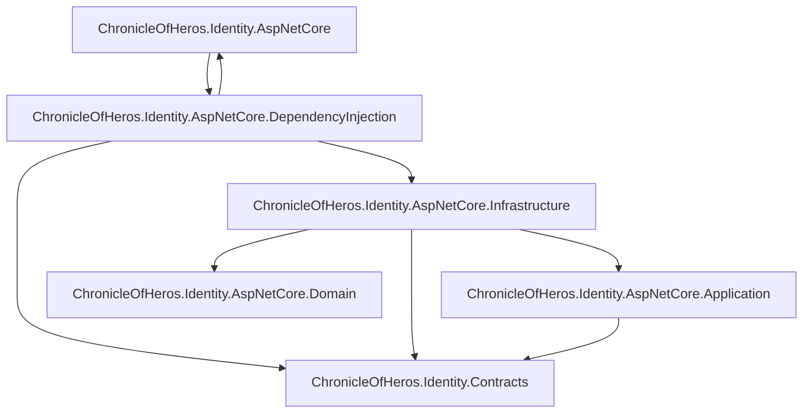

# Identity: components

Scope: the Identity capability's projects, internal layers, and the dependencies between them.
Load when: moving an Identity type between layers or namespaces, or adding a dependency between Identity layers or on its contracts.
Parent: [index.md](index.md) · Neighbours: [classes.md](classes.md), [../../solution/projects.md](../../solution/projects.md)

Each node is a namespace; a type belongs to the node with the longest matching namespace prefix. `X --> Y` means a type in X depends on a type in Y in compiled code.

| Node | Types (public in bold) |
|---|---|
| `…AspNetCore` (registration surface) | **`AspNetCoreIdentityRegistration`** (`AddAspNetCoreIdentity`), **`AspNetCoreIdentityRegistrationOptions`** (`EnableMigrations`) |
| `…DependencyInjection` | `IdentityCapabilityRegistration`, `IdentityMigrationHostedService`, `BootstrapOperatorHostedService` |
| `…Infrastructure.Identity` | `AuthenticationService`, `PlayerAdministrationService`, `PlayerIdentityService`, `AuthenticationTokenService`, `JwtKeyMaterial`, `JwtOptions`, `BootstrapOperatorOptions`, `BootstrapOperatorInitializer`, `ApplicationUser`, `RefreshSession`, `IdentityPersistence`, and extension containers for registration options, persistence options, and `IdentityResult` |
| `…Infrastructure.Data` (+ `.Configurations`, `.Migrations`) | `ChronicleOfHerosDbContext`, `ApplicationUserConfiguration`, `RefreshSessionConfiguration`, generated migrations and snapshot |
| `…Application` | `IdentityOperationResults` (factory for contract results) |
| `…Domain` | `ApplicationRoles` (constants), `UsernameValidator` |
| `ChronicleOfHeros.Identity.Contracts` | **3 service interfaces, request and response records, `IdentityOperationResult<T>`, `IdentityFailure`, `IdentityFailureKind`** |

- Domain depends on no other node. `ApplicationRoles` holds constants, which compile into their users and create no edge.
- Application holds no services or ports. The contract services live in Infrastructure and use ASP.NET Core Identity's `UserManager<ApplicationUser>` and EF Core directly ([classes.md](classes.md)).
- `IdentityCapabilityRegistration` reads `AspNetCoreIdentityRegistrationOptions`; that is the DependencyInjection → registration edge.
- Contracts reference no project and no implementation framework.
- Architecture tests ([../../solution/projects.md](../../solution/projects.md)) check that Domain uses no other layer, Application uses neither Infrastructure nor DependencyInjection, Infrastructure does not use DependencyInjection, only DependencyInjection assembles services, and the public surface is the two registration types.

## Known deviations

- The contract services and their workflows live in Infrastructure, not Application, and Application owns no ports. Deviates from [CODING_STANDARDS.md § Implementation layers](../../../../CODING_STANDARDS.md#implementation-layers) and [ADR 0007](../../../adr/0007-contract-first-capability-architecture.md): Application holds behavior and depends only on Domain, contracts, and its private ports, which Infrastructure implements. Tracking: not yet filed.
