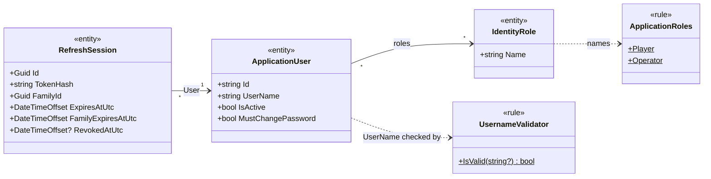

# Identity: domain

Scope: the Identity concepts and rules as the code implements them: accounts, roles, Usernames, credentials, and refresh-session families.
Load when: changing roles, Username rules, temporary credentials, password rules, account state, or Player and Operator concepts.
Parent: [index.md](index.md) · Neighbours: [classes.md](classes.md), [persistence.md](persistence.md), [state.md](state.md)

Terms follow [GLOSSARY.md](../../../../GLOSSARY.md). The `Domain` namespace holds only `ApplicationRoles` and `UsernameValidator`; the account and session entities live in `Infrastructure.Identity` ([components.md](components.md)).

| Concept | As implemented |
|---|---|
| Account ID | `ApplicationUser.Id`, a GUID string created by ASP.NET Core Identity. Exposed as `Guid AccountId` in contracts and as the JWT `sub` claim. |
| [Player](../../../../GLOSSARY.md#player) | An account with role `Player`. Enrollment assigns only `Player`. |
| [Operator](../../../../GLOSSARY.md#operator) | An account with roles `Player` and `Operator`. Only the bootstrap Operator gets `Operator`; no endpoint grants it. |
| [Username](../../../../GLOSSARY.md#username) | Trimmed, then matched against `^[A-Za-z0-9][A-Za-z0-9_.-]{1,30}[A-Za-z0-9]$` (3–32 characters, letter or digit at both ends). Stored as entered; Identity's upper-cased `NormalizedUserName` is unique and used for lookup, so Usernames are case-insensitive. |
| Temporary credential | `Aa` + 32 uppercase hexadecimal characters from 16 random bytes + `!1`. Issued by [Player enrollment](../../../../GLOSSARY.md#player-enrollment) and Operator reset, returned once, never stored in plain text. |
| Password rules | At least 8 characters with a digit, a lowercase letter, an uppercase letter, and a non-alphanumeric character. The bootstrap Operator's temporary password must also be 8–128 characters. |
| Must change password | `MustChangePassword` is `true` for new accounts and after a reset, and `false` after a password change. While `true`, sign-in yields only a restricted access token ([state.md](state.md)). |
| Active account | `IsActive` defaults to `true`; sign-in, password change, and refresh reject inactive accounts. No code sets it to `false`. |
| Refresh-session family | All refresh sessions descending from one sign-in or password change share a `FamilyId` and its 90-day absolute expiry. Replay or sign-out revokes the whole family ([state.md](state.md)). |

- Roles exist only after the bootstrap Operator initializer creates them; migrations seed no data ([../../flows/startup.md](../../flows/startup.md)).
- An Operator can reset any account's password by Username, including another Operator's.
