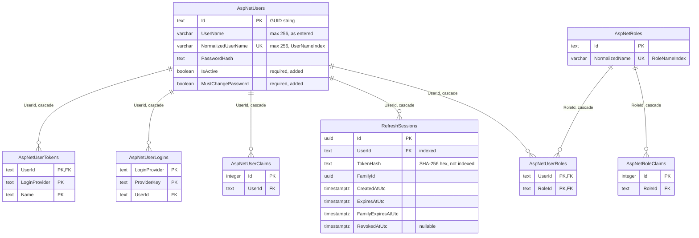

# Identity: persistence

Scope: `ChronicleOfHerosDbContext`, its entities, tables, relationships, indexes, and migrations.
Load when: changing an Identity entity, configuration, index, relationship, or migration, or how the context is registered.
Parent: [index.md](index.md) · Neighbours: [domain.md](domain.md), [state.md](state.md), [../../hosts/migrations.md](../../hosts/migrations.md)

`ChronicleOfHerosDbContext` (internal, `Infrastructure.Data`) derives from `IdentityDbContext<ApplicationUser, IdentityRole, string>` and adds `DbSet<RefreshSession> RefreshSessions`. `OnModelCreating` calls the base model, then applies `ApplicationUserConfiguration` and `RefreshSessionConfiguration` explicitly.

<!-- verify: dbcontext-entities:ChronicleOfHerosDbContext -->
| Entity | Table |
|---|---|
| `ApplicationUser` | AspNetUsers |
| `RefreshSession` | RefreshSessions |
| `IdentityRole` | AspNetRoles |
| `IdentityRoleClaim<string>` | AspNetRoleClaims |
| `IdentityUserClaim<string>` | AspNetUserClaims |
| `IdentityUserLogin<string>` | AspNetUserLogins |
| `IdentityUserRole<string>` | AspNetUserRoles |
| `IdentityUserToken<string>` | AspNetUserTokens |

- `AspNetUsers` keeps every standard ASP.NET Core Identity column (email, phone, lockout, two-factor, stamps); the diagram shows only those the code uses. `ApplicationUser` adds `IsActive` and `MustChangePassword`.
- Refresh tokens are stored only as the uppercase hexadecimal SHA-256 hash of the 64-byte random token. Lookups by `TokenHash` scan the table; there is no index on it.
- There are no navigations from `ApplicationUser` to `RefreshSession`; `RefreshSession.User` is the only navigation.
- Migrations seed no data.

## Migrations

| Migration | Change |
|---|---|
| `20260818193458_InitialIdentity` | Identity tables, `AspNetUsers.IsActive` and `MustChangePassword`, `RefreshSessions` |
| `20260819160000_AddRefreshSessionFamilyExpiry` | Adds `RefreshSessions.FamilyExpiresAtUtc` |

The model snapshot was generated with EF Core 10.0.11. Migrations live in `Infrastructure/Data/Migrations` and run only through the Migrations host ([../../hosts/migrations.md](../../hosts/migrations.md)).

## Registration

`AddNpgsqlDbContext<ChronicleOfHerosDbContext>("chronicleofheros", …)` from the Aspire Npgsql EF Core integration registers the context with the connection string `ConnectionStrings:chronicleofheros`, keeps retries enabled (`DisableRetry = false`), and adds the integration's health check and telemetry. The refresh rotation runs inside the context's execution strategy and an explicit transaction ([../../flows/authentication.md](../../flows/authentication.md)).
