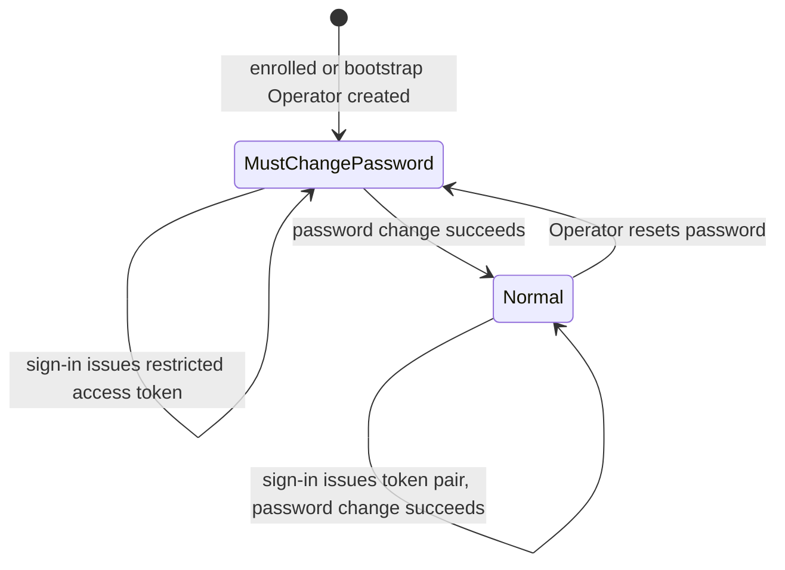
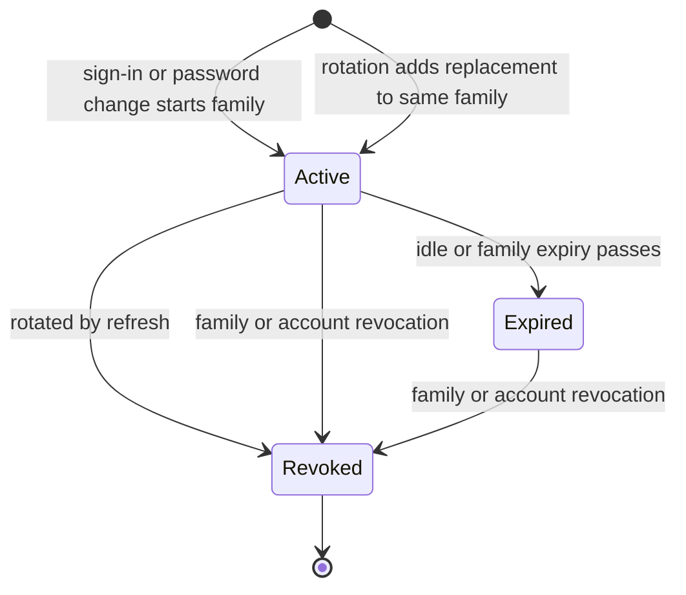

# Identity: state

Scope: the lifecycles the Identity code implements: an account's password-change requirement and a refresh session.
Load when: changing sign-in, password change, password reset, refresh rotation, sign-out, or revocation rules.
Parent: [index.md](index.md) · Neighbours: [domain.md](domain.md), [persistence.md](persistence.md), [../../flows/authentication.md](../../flows/authentication.md)

## Account password state

- The state is `ApplicationUser.MustChangePassword`. `IsActive` is checked separately and never becomes `false` in the current code.
- A restricted access token lives 5 minutes, carries `scope=password-change` and no role claims, and satisfies only the `PasswordChange` policy.
- A successful password change and an Operator reset both revoke all of the account's refresh sessions. The password change then starts a new refresh-session family.

## Refresh session

| State | Condition on `RefreshSession` |
|---|---|
| Active | `RevokedAtUtc` is null and now is before `ExpiresAtUtc` and `FamilyExpiresAtUtc` |
| Expired | `RevokedAtUtc` is null and `ExpiresAtUtc` or `FamilyExpiresAtUtc` has passed; nothing is written when it expires |
| Revoked | `RevokedAtUtc` is set; it is never cleared |

- A new family gets `FamilyExpiresAtUtc` = creation + 90 days. Every session gets `ExpiresAtUtc` = creation + 30 days, capped at the family expiry.
- **Rotation.** Presenting an active session's token revokes it with a conditional update (`RevokedAtUtc` still null) and adds a replacement in the same family, in one transaction.
- **Family revocation** sets `RevokedAtUtc` on every unrevoked session of the family. It happens on sign-out, and on refresh when the presented session is revoked (replay), expired, or belongs to an inactive account, or when the conditional update loses a race.
- **Account revocation** sets `RevokedAtUtc` on every unrevoked session of the account, on password change and Operator reset.
- A token whose hash matches no session fails with 401 and revokes nothing.
