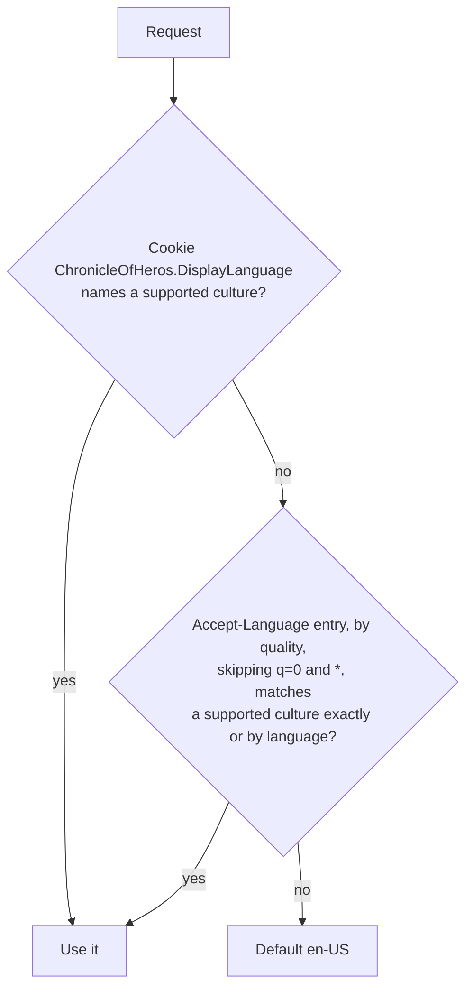

# Cross-cutting: localization

Scope: how the Web host selects the display language and resolves localized text.
Load when: changing supported display languages, culture selection, the display-language selector or cookie, or resource files and fallback.
Parent: [ARCHITECTURE.md](../../../ARCHITECTURE.md) · Neighbours: [security.md](security.md), [observability.md](observability.md), [../hosts/web.md](../hosts/web.md)

Only the Web host localizes. The API returns no localized text; its validation messages are English Identity error descriptions. Terms such as display language follow [GLOSSARY.md](../../../GLOSSARY.md).

## Culture selection

- Supported cultures, used for both culture and UI culture: `en-US` (default) and `de-DE`, declared once in Web `Program.cs`.
- `RequestLocalizationOptions.ConfigureDisplayLanguages` replaces the default providers with `DisplayLanguageRequestCultureProvider` only, so query strings and the ASP.NET Core culture cookie are ignored. `ApplyCurrentCultureToResponseHeaders` adds `Content-Language`.
- A language match picks the first supported culture with the same two-letter language, e.g. `de-AT` → `de-DE`, `en-GB` → `en-US`.
- `App.razor` writes the two-letter UI language into `<html lang>`.

## Display-language selector

`DisplayLanguageSelector` renders a form with an antiforgery token, a `returnUrl`, and a `locale` select that submits on change to `POST /display-language` ([../hosts/web.md](../hosts/web.md)). The endpoint:

1. Validates antiforgery; 400 on failure.
2. When `locale` matches a supported culture (case-insensitive), sets cookie `ChronicleOfHeros.DisplayLanguage`: 400 days (`Expires` and `Max-Age`), `HttpOnly`, `Secure`, `SameSite=Lax`, `Path=/`. An unsupported value sets nothing.
3. Redirects with 302 to `returnUrl` if it is a safe local path (relative; after repeated URL-decoding it starts with a single `/` and contains no `\`), else to `/`.

## Resources

- Each page and layout component owns `<Component>.resx` (neutral, English, the canonical key set) and `<Component>.de-DE.resx` beside it, and injects `IStringLocalizer<Component>`.
- `Localization/SharedResources` (`.resx`, `.de-DE.resx`) holds shared vocabulary; today only the language names English and German.
- `MissingTranslationDiagnosticStringLocalizerFactory` replaces `IStringLocalizerFactory`. It wraps the ResourceManager factory: a missing localized value falls back to the English resource; a key missing from English renders the key and logs the warning "Translation key {TranslationKey} is missing from its canonical English resource."
- `SharedResources` and the factory are public only for `TranslationResourceTests` in `ChronicleOfHeros.AppHost.Tests`, which check key parity with English, English fallback, and the missing-key warning.

## Known deviations

- English (`en-US`) text comes from the neutral `.resx` resources; no resource has an `en-US` suffix. Deviates from [CODING_STANDARDS.md § Localization](../../../CODING_STANDARDS.md#localization) and [GLOSSARY.md § Supported display language](../../../GLOSSARY.md#supported-display-language): every supported display language has a resource with a concrete locale suffix. Tracking: not yet filed.
