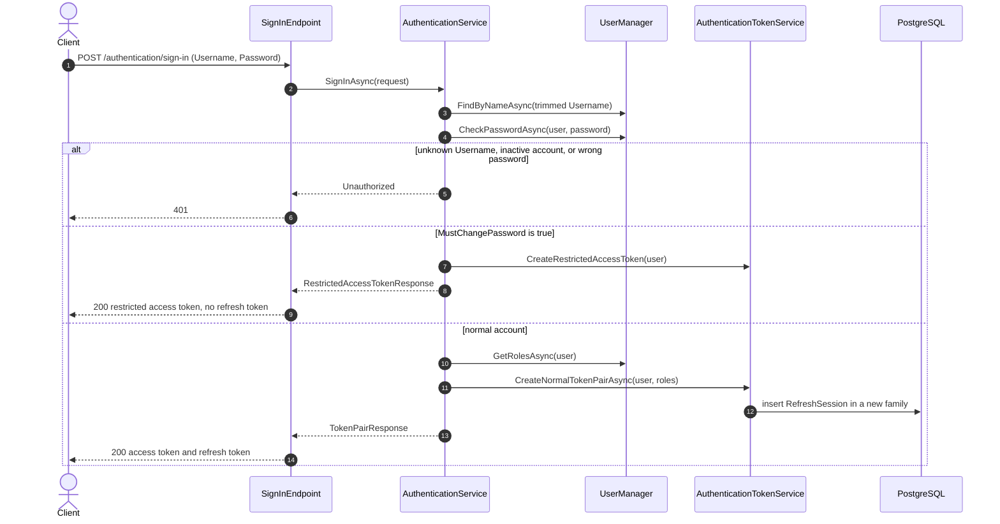
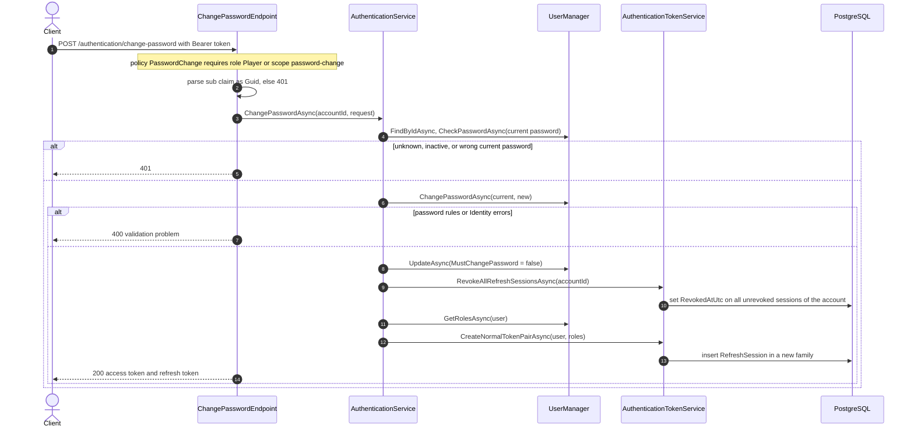
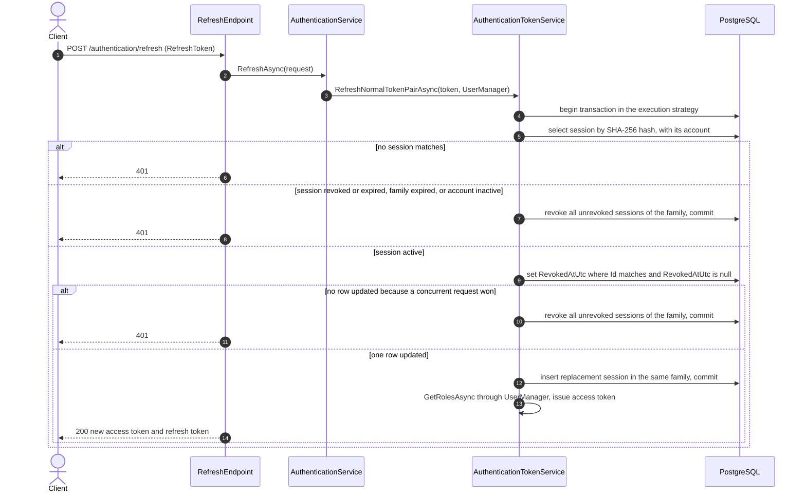
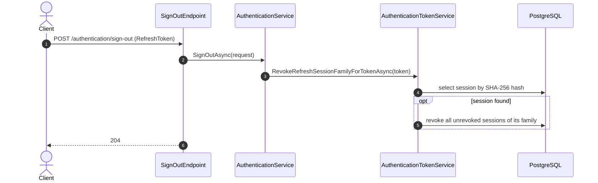

# Flows: authentication

Scope: sign-in, password change, refresh rotation with replay revocation, and sign-out, as the API implements them today.
Load when: changing any `/authentication/*` endpoint, token issuing, refresh-session rotation or revocation, or the must-change-password rule.
Parent: [ARCHITECTURE.md](../../../ARCHITECTURE.md) · Neighbours: [player-administration.md](player-administration.md), [startup.md](startup.md), [../capabilities/identity/state.md](../capabilities/identity/state.md)

"Client" is any HTTP client of the API, calling it directly over HTTPS; the Web host exposes no route to it ([../hosts/web.md](../hosts/web.md)). `UserManager` reads and writes `AspNetUsers` and `AspNetUserRoles` through its EF stores. Token lifetimes and claims: [../cross-cutting/security.md](../cross-cutting/security.md).

## Sign-in

Failed sign-ins do not count toward lockout; there is no lockout or rate limiting.

## Password change

The password change and the `MustChangePassword` update are separate `UserManager` calls without a shared transaction. Access tokens issued earlier stay valid until they expire.

## Refresh rotation and replay

A blank refresh token returns 401 without a database call. Presenting a rotated token again is a replay and revokes the family.

## Sign-out

Sign-out is anonymous: the refresh token alone authorizes revoking its family.

## Known deviations

- Clients call the API authentication endpoints directly and receive access and refresh tokens in JSON; Web offers no sign-in, sign-out, or password change. Deviates from [ADR 0004](../../adr/0004-same-origin-web-api-gateway.md): the authentication, refresh, and sign-out endpoints are never browser-proxied, Web holds the tokens in a server-side session, and browser sign-in, sign-out, and password change are static SSR form posts. Tracking: #84.
