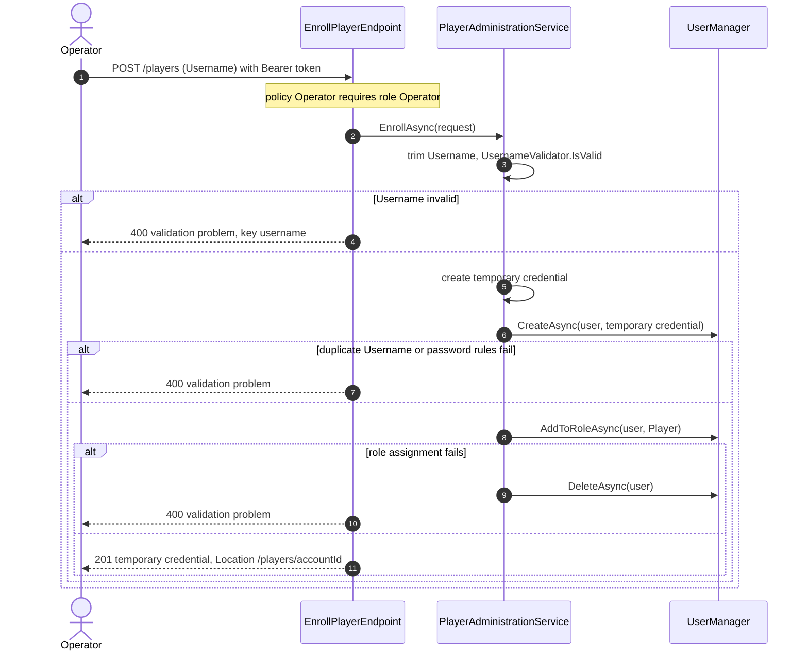
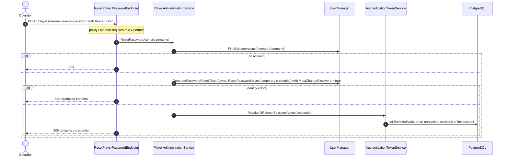

# Flows: Player administration

Scope: Player enrollment, Operator password reset, and current-Player lookup, as the API implements them today.
Load when: changing `/players` endpoints, enrollment, password reset, temporary credentials, or the current-Player lookup.
Parent: [ARCHITECTURE.md](../../../ARCHITECTURE.md) · Neighbours: [authentication.md](authentication.md), [web-forwarding.md](web-forwarding.md), [startup.md](startup.md), [../capabilities/identity/domain.md](../capabilities/identity/domain.md)

> Pending approved changes: #75

"Client" is any HTTP client of the API holding a valid access token ([authentication.md](authentication.md)). `UserManager` persists through its EF stores.

## Player enrollment

The new account has `MustChangePassword = true`; the Player's first sign-in yields a restricted access token. Account creation and role assignment run without a shared transaction; a failed role assignment is compensated by deleting the account.

## Operator password reset

The reset does not check the target's roles or `IsActive`, so it also applies to Operator accounts. Access tokens issued earlier stay valid until they expire.

## Current Player

`GET /players/me` requires policy `Player`. `CurrentPlayerEndpoint` parses the `sub` claim as a `Guid` (401 when it is not one), `PlayerIdentityService.GetAsync` finds the account by ID (404 when absent), and the endpoint returns 200 with `PlayerIdentityResponse(AccountId)`.
