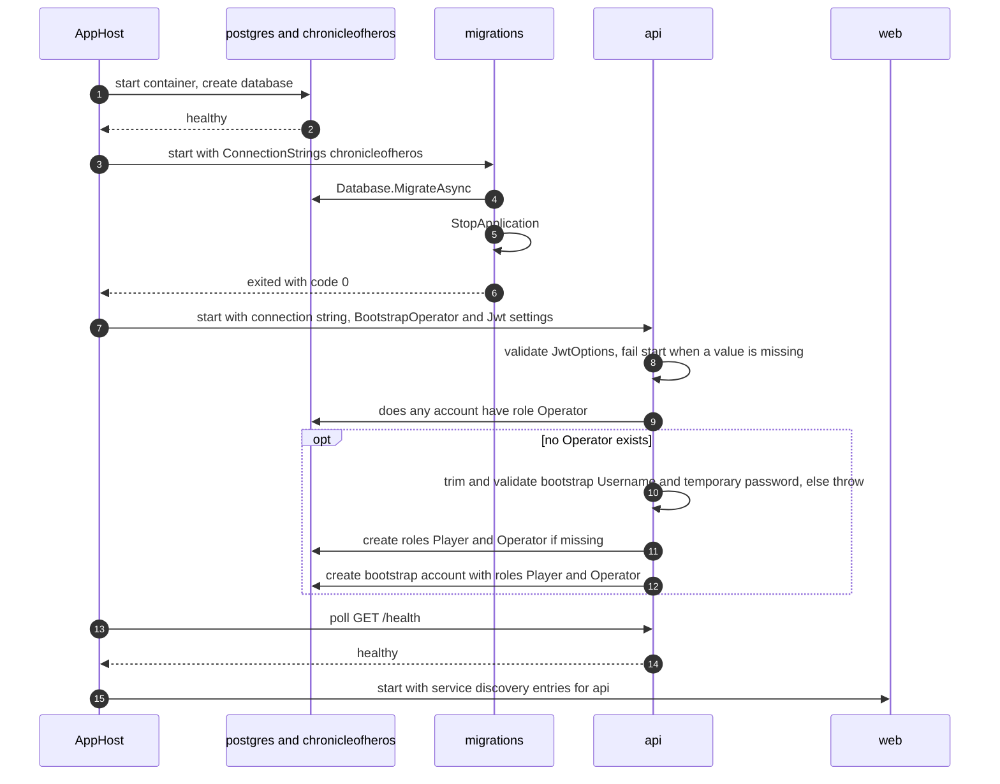

# Flows: startup

Scope: the distributed-application start sequence: database, migrations, API with bootstrap Operator, and Web.
Load when: changing start order, wait conditions, health checks, schema migration at startup, startup validation, or the bootstrap Operator.
Parent: [ARCHITECTURE.md](../../../ARCHITECTURE.md) · Neighbours: [authentication.md](authentication.md), [player-administration.md](player-administration.md), [web-forwarding.md](web-forwarding.md), [../system/deployment.md](../system/deployment.md)

> Pending approved changes: #75

- `WaitFor` waits until a resource is running and healthy; `WaitForCompletion` waits until it exits successfully. A failed migration therefore keeps the API and Web from starting.
- The bootstrap Operator runs in `BootstrapOperatorHostedService` on every API start and changes nothing once any account has the `Operator` role. The created account has `MustChangePassword = true` ([../capabilities/identity/state.md](../capabilities/identity/state.md)). Invalid bootstrap configuration or a failed Identity operation throws and stops the API.
- Account creation and role assignment are separate calls without a shared transaction.
- A malformed `Jwt:SigningPrivateKey` passes start-up validation; it fails when `JwtKeyMaterial` is first resolved, which the authentication middleware triggers on the first HTTP request ([../capabilities/identity/classes.md](../capabilities/identity/classes.md)).
- The AppHost `/health` check works only in the Development environment, where `MapDefaultEndpoints` maps it ([../cross-cutting/observability.md](../cross-cutting/observability.md)).

## Known deviations

- Every distributed-application start applies migrations before starting the API. Deviates from [CODING_STANDARDS.md § Registration and composition](../../../CODING_STANDARDS.md#registration-and-composition): normal application and distributed-application startup do not run migrations. Tracking: not yet filed.
- A malformed JWT signing key is detected at first use, not at startup. Deviates from [CODING_STANDARDS.md § Registration and composition](../../../CODING_STANDARDS.md#registration-and-composition): required invalid configuration fails at startup. Tracking: not yet filed.
