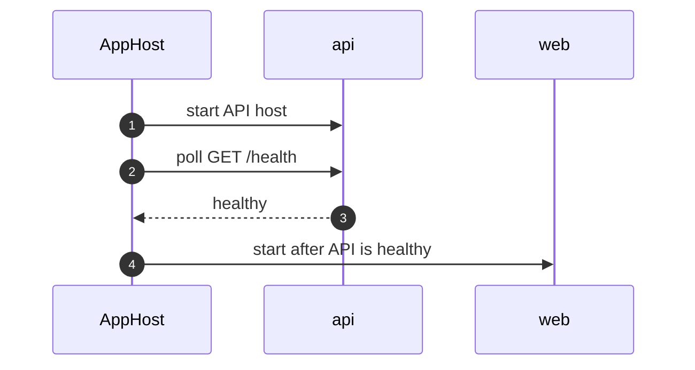

# Flows: startup

Scope: the distributed-application start sequence and resource readiness.
Load when: changing start order, wait conditions, or health checks.
Parent: [ARCHITECTURE.md](../../../ARCHITECTURE.md) · Neighbours: [../system/deployment.md](../system/deployment.md)

- The AppHost waits for API health before starting Web. The API health check polls `/health`, which exists only in Development ([../cross-cutting/observability.md](../cross-cutting/observability.md)).
- No application database or migration host is currently part of startup.
