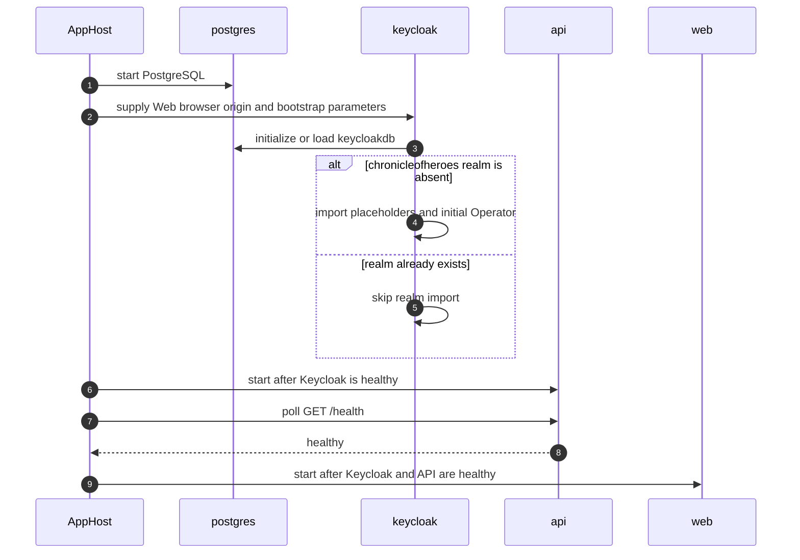

# Flows: startup

Scope: the distributed-application start sequence and resource readiness.
Load when: changing start order, wait conditions, or health checks.
Parent: [ARCHITECTURE.md](../../../ARCHITECTURE.md) · Neighbours: [../system/deployment.md](../system/deployment.md)

- The AppHost waits for Keycloak before starting API, and for Keycloak and API health before starting Web. The host health checks poll `/health`, which exists only in Development ([../cross-cutting/observability.md](../cross-cutting/observability.md)).
- Web's browser-facing origin is resolved from its allocated endpoint, not its running process, so this configuration does not add a startup wait cycle.
- The initial realm user has Player and Operator roles and must change the supplied password at first login. Startup never reprovisions a deleted user in an existing realm.
- No application database or migration host is currently part of startup.
