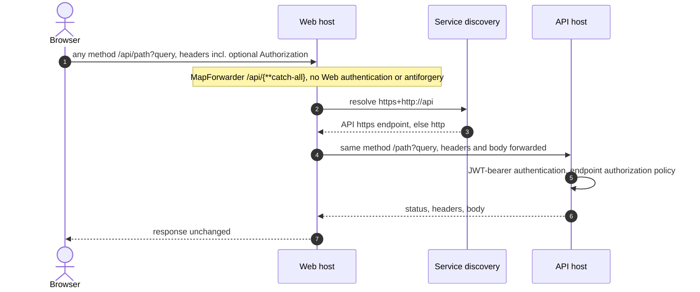

# Flows: Web forwarding

Scope: how a browser request reaches the API through the Web host today.
Load when: changing the `/api` forwarder, browser-to-API calls, service discovery between Web and API, or Web-side API authentication.
Parent: [ARCHITECTURE.md](../../../ARCHITECTURE.md) · Neighbours: [authentication.md](authentication.md), [player-administration.md](player-administration.md), [startup.md](startup.md), [../hosts/web.md](../hosts/web.md)

> Pending approved changes: #75

- The only transform is `AddPathRemovePrefix("/api")`. YARP's default request and response header handling applies, so the browser's `Authorization` header reaches the API and token-bearing JSON bodies reach the browser.
- The Web host's `/api` route has no authorization or antiforgery requirement; the API authorizes each request.
- The AppHost gives Web a reference to `api` ([../system/deployment.md](../system/deployment.md)), which supplies the service-discovery configuration for `https+http://api`.
- No Web component calls the API today; the forwarder is the only path ([../hosts/web.md](../hosts/web.md)).

## Known deviations

- A blanket `/api/{**catch-all}` forwarder passes browser-supplied bearer tokens and returns API tokens to the browser. Deviates from [ADR 0004](../../adr/0004-same-origin-web-api-gateway.md) and [CODING_STANDARDS.md § Web and security boundaries](../../../CODING_STANDARDS.md#web-and-security-boundaries): capability-owned browser adapters set `Authorization` from the Web session, ignore browser-supplied `Authorization` headers, strip token data from responses, and never proxy authentication, refresh, or sign-out. Tracking: #76.
