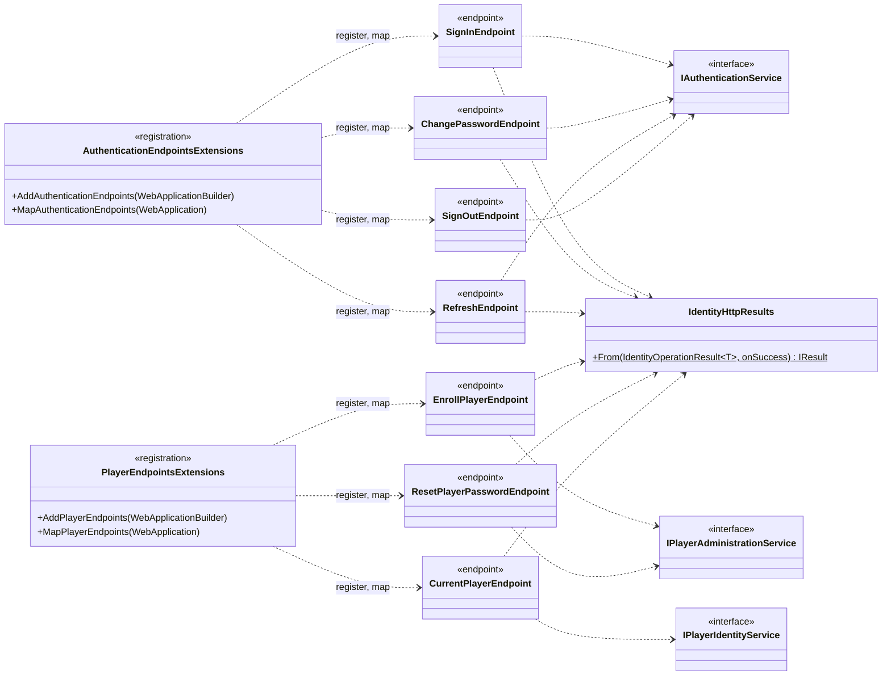

# Hosts: API

Scope: the `ChronicleOfHeros.Api` host: composition, request pipeline, HTTP endpoints, endpoint adapters, and result mapping.
Load when: adding or changing an API endpoint, its route, authorization, or HTTP result, or the API host's composition.
Parent: [ARCHITECTURE.md](../../../ARCHITECTURE.md) · Neighbours: [web.md](web.md), [migrations.md](migrations.md), [../flows/authentication.md](../flows/authentication.md), [../flows/player-administration.md](../flows/player-administration.md)

## Composition and pipeline

`Program.cs` (top-level statements), in order:

1. `AddServiceDefaults()` ([../cross-cutting/observability.md](../cross-cutting/observability.md)).
2. `AddAspNetCoreIdentity()` without options: the full Identity capability, including JWT-bearer authentication, authorization policies, and the bootstrap Operator hosted service ([../capabilities/identity/classes.md](../capabilities/identity/classes.md)).
3. `AddAuthenticationEndpoints()`, `AddPlayerEndpoints()`: register each endpoint adapter as scoped, built by an explicit factory from its contract interface.
4. `UseAuthentication()`, `UseAuthorization()`, `MapDefaultEndpoints()`, `MapAuthenticationEndpoints()`, `MapPlayerEndpoints()`.

The API has no HTTPS redirection, exception handler, CORS, or antiforgery middleware, and no `appsettings` files; configuration comes from the AppHost ([../system/deployment.md](../system/deployment.md)). Routes are mapped at the root without a group.

## Endpoints

<!-- verify: api-endpoints -->
| Method | Route | Adapter | Authorization |
|---|---|---|---|
| POST | /authentication/sign-in | SignInEndpoint | Anonymous |
| POST | /authentication/change-password | ChangePasswordEndpoint | Policy:PasswordChange |
| POST | /authentication/refresh | RefreshEndpoint | Anonymous |
| POST | /authentication/sign-out | SignOutEndpoint | Anonymous |
| POST | /players | EnrollPlayerEndpoint | Policy:Operator |
| POST | /players/{username}/reset-password | ResetPlayerPasswordEndpoint | Policy:Operator |
| GET | /players/me | CurrentPlayerEndpoint | Policy:Player |

| Route | Body in | Success |
|---|---|---|
| /authentication/sign-in | `SignInRequest` | 200 `RestrictedAccessTokenResponse` or `TokenPairResponse` |
| /authentication/change-password | `ChangePasswordRequest` | 200 `TokenPairResponse` |
| /authentication/refresh | `RefreshTokenRequest` | 200 `TokenPairResponse` |
| /authentication/sign-out | `RefreshTokenRequest` | 204, always |
| /players | `EnrollPlayerRequest` | 201 `TemporaryCredentialResponse`, `Location: /players/{accountId}` (no route serves it) |
| /players/{username}/reset-password | — | 200 `TemporaryCredentialResponse` |
| /players/me | — | 200 `PlayerIdentityResponse` |

Policies are described in [../cross-cutting/security.md](../cross-cutting/security.md). Tokens travel in JSON bodies and the `Authorization: Bearer` header; the API sets no cookies.

## Endpoint adapters

- All types are internal, in `ChronicleOfHeros.Api.Authentication`. `AuthenticationEndpoints.cs` holds the authentication extension container and its four adapters; `PlayerEndpoints.cs` holds the player extension container and its three adapters.
- Each adapter has a static `Map(IEndpointRouteBuilder)` that maps one route to a lambda. The lambda receives the adapter from DI and calls its private `HandleAsync`, which calls one contract operation.
- `ChangePasswordEndpoint` and `CurrentPlayerEndpoint` parse the JWT `sub` claim as a `Guid`; when it is missing or not a GUID they return 401 without calling the service.
- `IdentityHttpResults.From` maps a failure: `Unauthorized` → 401, `NotFound` → 404, `Validation` → 400 validation problem with the errors, any other kind → 500 problem.
- Policy names are string literals in the adapters and in Identity's policy registration; no constant is shared.
