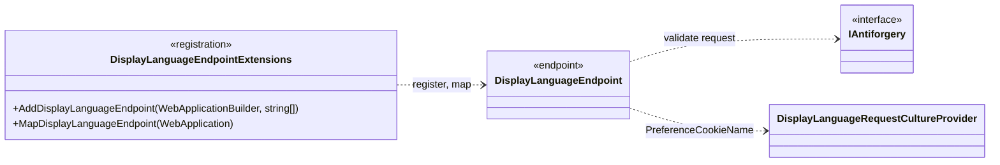
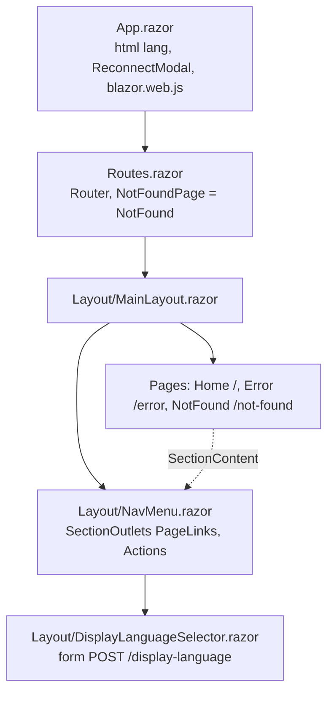

# Hosts: Web

Scope: the `ChronicleOfHeros.Web` host: composition, request pipeline, render modes, endpoints and endpoint adapters, and Razor components.
Load when: changing the Web pipeline, a page or layout component, render modes, a Web endpoint, or how the browser reaches the API.
Parent: [ARCHITECTURE.md](../../../ARCHITECTURE.md) · Neighbours: [api.md](api.md), [migrations.md](migrations.md), [../cross-cutting/localization.md](../cross-cutting/localization.md)

> Pending approved changes: #75

## Composition and pipeline

`Program.cs` (top-level statements), in order:

| Step | Code |
|---|---|
| Service defaults | `AddServiceDefaults()` ([../cross-cutting/observability.md](../cross-cutting/observability.md)) |
| Razor components | `AddRazorComponents().AddInteractiveServerComponents()` |
| Localization | `AddLocalization()`, `MissingTranslationDiagnosticStringLocalizerFactory` as `IStringLocalizerFactory`, `RequestLocalizationOptions.ConfigureDisplayLanguages(["en-US", "de-DE"])` ([../cross-cutting/localization.md](../cross-cutting/localization.md)) |
| Endpoint adapters | `AddDisplayLanguageEndpoint(["en-US", "de-DE"])` |
| Error handling | Outside Development only: `UseExceptionHandler("/error")` and `UseHsts()`. Always: `UseStatusCodePagesWithReExecute("/not-found")` |
| Middleware | `UseHttpsRedirection()`, `UseRequestLocalization()`, `UseAntiforgery()` |
| Endpoints | `MapStaticAssets()`, `MapRazorComponents<App>().AddInteractiveServerRenderMode()`, `MapDisplayLanguageEndpoint()`, `MapDefaultEndpoints()` |

The Web host has no authentication, authorization, session, or Data Protection configuration of its own, and references only `ChronicleOfHeros.ServiceDefaults`. It calls no API operation and exposes no route to the API, so browsers cannot reach the API through it.

## Endpoints

| Route | Kind | Behavior |
|---|---|---|
| `/`, `/error`, `/not-found` | Razor pages | Static server-side rendering |
| `POST /display-language` | `DisplayLanguageEndpoint` adapter | Validates antiforgery (400 on failure), stores the chosen culture in a cookie when supported, redirects (302) to a validated local return path ([../cross-cutting/localization.md](../cross-cutting/localization.md)) |
| `/health`, `/alive` | `MapDefaultEndpoints` | Development only |

The launch profile `https` listens on `https://localhost:7098` only; there is no plain-HTTP URL or `http` profile.

## Endpoint adapters

- Both types are internal, in `ChronicleOfHeros.Web.Endpoints`, each in its own file. `AddDisplayLanguageEndpoint` registers the adapter as scoped, built by an explicit factory from `IAntiforgery` and the supported cultures.
- The adapter's static `Map(IEndpointRouteBuilder)` maps `POST /display-language` to a lambda that receives the adapter from DI and calls its private `HandleAsync`. The adapter also owns the return-path validation.

## Render modes

- No component declares `@rendermode`, so every page renders as static server-side rendering. `App.razor` loads `blazor.web.js`, so enhanced navigation applies.
- The interactive server renderer is registered and its endpoints mapped (`AddInteractiveServerComponents`, `AddInteractiveServerRenderMode`), so a component can opt into `InteractiveServer`; none does today.
- There is no WebAssembly client project or render mode.

## Components

- `App.razor` sets `<html lang>` from the current UI culture and cascades `OriginalPathAndQuery` from the status-code re-execute feature. The selector posts that path, or else the current path, query, and fragment, as `returnUrl`.
- `Home` is a static landing page with a hard-coded example character record; its navigation links are in-page anchors and its action button is disabled.
- Every page and layout component injects `IStringLocalizer<Self>` and owns a neutral (English) `.resx` and a `.de-DE.resx` beside it; the selector also uses `SharedResources` for language names.

## Known deviations

- The Web host has no capability-owned browser adapters for API operations and no Web session. Deviates from [ADR 0004](../../adr/0004-same-origin-web-api-gateway.md) and [CODING_STANDARDS.md § Web and security boundaries](../../../CODING_STANDARDS.md#web-and-security-boundaries): explicit browser adapters, an opaque Web session cookie, and server-held tokens. Tracking: #76.
