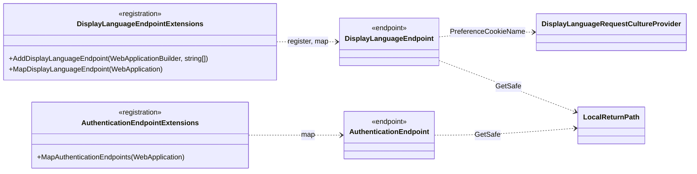
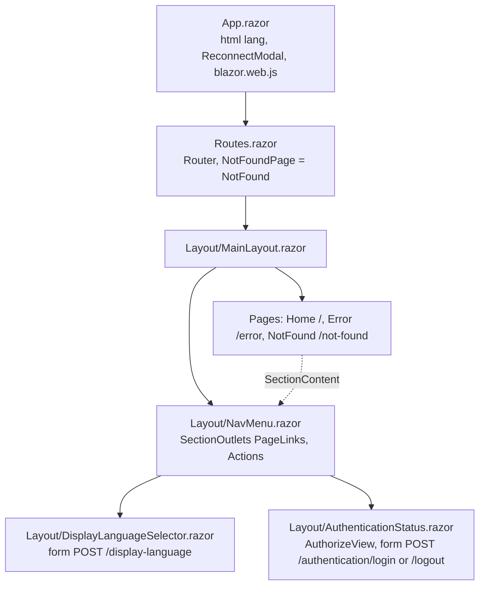

# Hosts: Web

Scope: the `ChronicleOfHeros.Web` host: composition, request pipeline, render modes, endpoints and endpoint adapters, and Razor components.
Load when: changing the Web pipeline, a page or layout component, render modes, a Web endpoint, or how the browser reaches the API.
Parent: [ARCHITECTURE.md](../../../ARCHITECTURE.md) · Neighbours: [api.md](api.md), [migrations.md](migrations.md), [../cross-cutting/localization.md](../cross-cutting/localization.md)

## Composition and pipeline

`Program.cs` (top-level statements), in order:

| Step | Code |
|---|---|
| Service defaults | `AddServiceDefaults()` ([../cross-cutting/observability.md](../cross-cutting/observability.md)) |
| Razor components | `AddRazorComponents().AddInteractiveServerComponents()` |
| Localization | `AddLocalization()`, `MissingTranslationDiagnosticStringLocalizerFactory` as `IStringLocalizerFactory`, `RequestLocalizationOptions.ConfigureDisplayLanguages(["en-US", "de-DE"])` ([../cross-cutting/localization.md](../cross-cutting/localization.md)) |
| Endpoint adapters | `AddDisplayLanguageEndpoint(["en-US", "de-DE"])` |
| Authentication | `AddAuthentication` with the cookie as default scheme and OpenID Connect as challenge scheme; `AddCookie()`; `AddKeycloakOpenIdConnect("keycloak", "chronicleofheroes")` with authority `https://keycloak/realms/chronicleofheroes`, public client `chronicleofheroes-web`, authorization-code flow, extra scope `chronicleofheroes:all`, `SaveTokens = true`, unmapped inbound claims, and `preferred_username` as name claim; `AddAuthorizationBuilder()` without policies; `AddCascadingAuthenticationState()` ([../cross-cutting/security.md](../cross-cutting/security.md)) |
| Error handling | Outside Development only: `UseExceptionHandler("/error")` and `UseHsts()`. Always: `UseStatusCodePagesWithReExecute("/not-found")` |
| Middleware | `UseHttpsRedirection()`, `UseRequestLocalization()`, `UseAuthentication()`, `UseAuthorization()`. ASP.NET Core's automatic CSRF protection is enabled implicitly; there is no explicit antiforgery middleware |
| Endpoints | `MapStaticAssets()`, `MapRazorComponents<App>().AddInteractiveServerRenderMode()`, `MapDisplayLanguageEndpoint()`, `MapAuthenticationEndpoints()`, `MapDefaultEndpoints()` |

The Web host has no server-side session store or Data Protection configuration of its own, and references only `ChronicleOfHeros.ServiceDefaults`. It calls no API operation and exposes no route to the API, so browsers cannot reach the API through it. The AppHost gives it service-discovery entries for `keycloak` and `api` (`WithReference(api)`, kept for the server-to-server API calls in [ADR 0004](../../adr/0004-same-origin-web-api-gateway.md)); it does not use `api` yet ([../system/deployment.md](../system/deployment.md)).

## Endpoints

| Route | Kind | Behavior |
|---|---|---|
| `/`, `/error`, `/not-found` | Razor pages | Static server-side rendering |
| `POST /display-language` | `DisplayLanguageEndpoint` adapter | Binds `locale` and `returnUrl` from the form, so a request failing the automatic CSRF check is rejected with 400; stores the chosen culture in a cookie when supported, redirects (302) to a validated local return path ([../cross-cutting/localization.md](../cross-cutting/localization.md)) |
| `POST /authentication/login` | `AuthenticationEndpoint` adapter | Requires the CSRF check; binds `returnUrl` from the form and starts the OpenID Connect challenge, returning to the validated local return path after sign-in |
| `POST /authentication/logout` | `AuthenticationEndpoint` adapter | Requires the CSRF check; signs out of the cookie and OpenID Connect schemes, which ends the Keycloak session, then returns to `/` |
| `/signin-oidc`, `/signout-callback-oidc` | OpenID Connect handler | Callback paths registered as the realm's redirect and post-logout redirect URIs |
| `/health`, `/alive` | `MapDefaultEndpoints` | Development only |

The launch profile `https` listens on `https://localhost:7098` only; there is no plain-HTTP URL or `http` profile.

## Endpoint adapters

- All types are internal, in `ChronicleOfHeros.Web.Endpoints`, each in its own file. `AddDisplayLanguageEndpoint` registers the display-language adapter as scoped, built by an explicit factory from the supported cultures.
- The display-language adapter's static `Map(IEndpointRouteBuilder)` maps `POST /display-language` to a lambda that receives the adapter from DI and the `[FromForm]` values, and calls its private `Handle`.
- `AuthenticationEndpoint` is static and has no DI registration. Its `Map` creates the `/authentication` route group with `RequireAntiforgeryTokenAttribute` metadata, so both posts require the CSRF check even without bound form values.
- `LocalReturnPath.GetSafe` owns the return-path validation: it returns the value only when it is a decoded local path without backslashes or protocol-relative prefixes, and `/` otherwise.

## Render modes

- No component declares `@rendermode`, so every page renders as static server-side rendering. `App.razor` loads `blazor.web.js`, so enhanced navigation applies.
- The interactive server renderer is registered and its endpoints mapped (`AddInteractiveServerComponents`, `AddInteractiveServerRenderMode`), so a component can opt into `InteractiveServer`; none does today.
- There is no WebAssembly client project or render mode.

## Components

- `App.razor` sets `<html lang>` from the current UI culture and cascades `OriginalPathAndQuery` from the status-code re-execute feature. The selector and the sign-in form post that path, or else the current path, query, and fragment, as `returnUrl`.
- `AuthenticationStatus` renders statically on every page, first in the navigation actions. Anonymous users see a **Sign in** button. Signed-in users see a localized greeting ("Hi, {name}!") with the `name` claim, falling back to `User.Identity.Name` (`preferred_username`) when it is empty, and a **Sign out** button.
- `Home` is a static landing page with a hard-coded example character record; its navigation links are in-page anchors. It contributes no navigation actions.
- Every page and layout component injects `IStringLocalizer<Self>` and owns a neutral (English) `.resx` and a `.de-DE.resx` beside it; the selector also uses `SharedResources` for language names.

## Known deviations

- The Web host has no server-side session store and makes no server-to-server API calls. Deviates from [ADR 0004](../../adr/0004-same-origin-web-api-gateway.md): sign-in keeps a Keycloak OpenID Connect cookie session whose encrypted cookie holds the OIDC tokens, instead of an opaque Redis-backed session with server-held API tokens. Tracking: #96.
