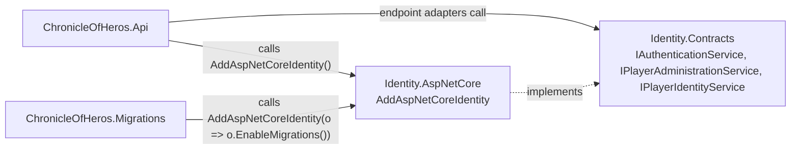

# Solution: capabilities

Scope: which capabilities exist, what each owns, and how hosts install and consume them.
Load when: adding a capability, moving behavior between capabilities or hosts, or wiring a capability into a host.
Parent: [ARCHITECTURE.md](../../../ARCHITECTURE.md) · Neighbours: [projects.md](projects.md), [../capabilities/identity/index.md](../capabilities/identity/index.md)

A capability is one public contracts project plus one implementation project ([ADR 0007](../../adr/0007-contract-first-capability-architecture.md)). Identity is the only capability today.

| Capability | Contracts | Implementation | Public registration API | Owns |
|---|---|---|---|---|
| Identity | `ChronicleOfHeros.Identity.Contracts` | `ChronicleOfHeros.Identity.AspNetCore` | `builder.AddAspNetCoreIdentity(Action<AspNetCoreIdentityRegistrationOptions>?)`; option `EnableMigrations()` | Player accounts, roles, passwords, refresh sessions, JWT issuing and validation, authorization policies, `ChronicleOfHerosDbContext` and its migrations |

- **Api** installs Identity once without options and receives the contract services, JWT-bearer authentication, and the `Player`, `PasswordChange`, and `Operator` policies. Its endpoint adapters depend only on contracts ([../hosts/api.md](../hosts/api.md)).
- **Migrations** installs Identity with `EnableMigrations()`, which registers only the `DbContext` and the migration hosted service ([../hosts/migrations.md](../hosts/migrations.md)).
- **Web** and **ServiceDefaults** use no capability.
- Architecture tests check that each host calls the registration once with the right options and that the public registration type assembles no services itself.
