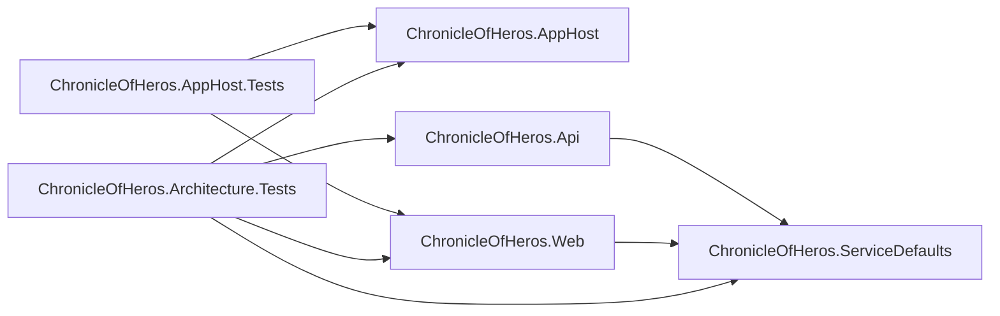

# Solution: projects

Scope: the projects in `ChronicleOfHeros.slnx`, their project references, and their production packages.
Load when: adding, removing, or renaming a project; changing a `<ProjectReference>`; adding a production NuGet package.
Parent: [ARCHITECTURE.md](../../../ARCHITECTURE.md) · Neighbours: [capabilities.md](capabilities.md)

`A --> B` means project A has a `<ProjectReference>` to project B.

| Project | Role | Production packages beyond the SDK |
|---|---|---|
| `ChronicleOfHeros.AppHost` | Aspire orchestrator; adds hosts by path, not by reference | `Aspire.Hosting.Dotnet` |
| `ChronicleOfHeros.Api` | Executable ASP.NET Core host; currently only shared health endpoints | none |
| `ChronicleOfHeros.Web` | Executable host: Blazor Web App | none |
| `ChronicleOfHeros.ServiceDefaults` | Shared host defaults: telemetry, health, service discovery, resilience | `Microsoft.Extensions.Http.Resilience`, `Microsoft.Extensions.ServiceDiscovery`, `OpenTelemetry.*` (exporter, hosting, ASP.NET Core, HTTP, runtime) |
| `ChronicleOfHeros.AppHost.Tests` | Distributed-application and Playwright browser tests | test only |
| `ChronicleOfHeros.Architecture.Tests` | ArchUnitNET, project-file, and doc-conformance rules | test only |

- Package versions are central in `Directory.Packages.props`.
- There is no shared or "common" project, no capability project, and no `ChronicleOfHeros.Web.Client` project.
- `tests/ChronicleOfHeros.Architecture.Tests` enforces project-reference rules and checks every verified architecture view against the code, in both directions ([../conventions.md § Verified views](../conventions.md#verified-views)).
