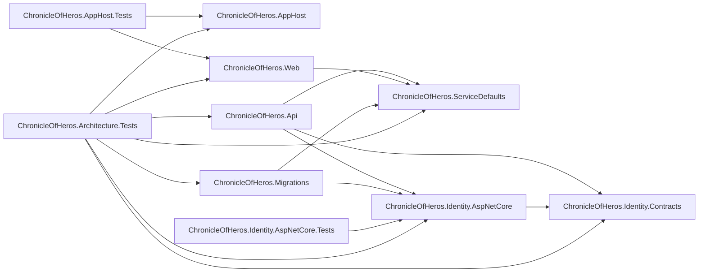

# Solution: projects

Scope: the projects in `ChronicleOfHeros.slnx`, their project references, and their production packages.
Load when: adding, removing, or renaming a project; changing a `<ProjectReference>`; adding a production NuGet package.
Parent: [ARCHITECTURE.md](../../../ARCHITECTURE.md) · Neighbours: [capabilities.md](capabilities.md), [../capabilities/identity/components.md](../capabilities/identity/components.md)

`A --> B` means project A has a `<ProjectReference>` to project B.

| Project | Role | Production packages beyond the SDK |
|---|---|---|
| `ChronicleOfHeros.AppHost` | Aspire orchestrator; adds hosts by path, not by reference | `Aspire.Hosting.Dotnet`, `Aspire.Hosting.PostgreSQL` |
| `ChronicleOfHeros.Api` | Executable host: internal JWT-bearer Minimal API | none |
| `ChronicleOfHeros.Web` | Executable host: Blazor Web App | none |
| `ChronicleOfHeros.Migrations` | Executable host: applies Identity migrations and exits | none |
| `ChronicleOfHeros.ServiceDefaults` | Shared host defaults: telemetry, health, service discovery, resilience | `Microsoft.Extensions.Http.Resilience`, `Microsoft.Extensions.ServiceDiscovery`, `OpenTelemetry.*` (exporter, hosting, ASP.NET Core, HTTP, runtime) |
| `ChronicleOfHeros.Identity.Contracts` | Identity capability's public contracts | none |
| `ChronicleOfHeros.Identity.AspNetCore` | Identity capability's implementation | `Aspire.Npgsql.EntityFrameworkCore.PostgreSQL`, `Microsoft.AspNetCore.Authentication.JwtBearer`, `Microsoft.AspNetCore.Identity.EntityFrameworkCore` |
| `ChronicleOfHeros.AppHost.Tests` | Distributed-application and Playwright browser tests | test only |
| `ChronicleOfHeros.Identity.AspNetCore.Tests` | Identity behavior tests against PostgreSQL Testcontainers | test only |
| `ChronicleOfHeros.Architecture.Tests` | ArchUnitNET and project-file rules | test only |

- Package versions are central in `Directory.Packages.props`.
- There is no shared or "common" project and no `ChronicleOfHeros.Web.Client` project.
- `tests/ChronicleOfHeros.Architecture.Tests` enforces the reference rules: Identity contracts reference no project and no implementation framework; only hosts and tests reference the Identity implementation; it grants no `InternalsVisibleTo`; Web is a single server project.

## Known deviations

- `ProjectReferenceRulesTests.Identity_implementation_references_are_limited_to_hosts_and_tests` fails on Windows: it compares `/`-separated literals with `Path.GetRelativePath` output that uses `\`. Deviates from [CODING_STANDARDS.md § Verification](../../../CODING_STANDARDS.md#verification): architecture tests pass. Tracking: not yet filed.
