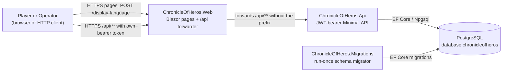

# System: context

Scope: who uses ChronicleOfHeros and which runtime parts and external systems exist today.
Load when: orienting in the system; changing actors, browser entry points, or external dependencies.
Parent: [ARCHITECTURE.md](../../../ARCHITECTURE.md) · Neighbours: [deployment.md](deployment.md), [../solution/projects.md](../solution/projects.md)

> Pending approved changes: #75

- **Actors.** A [Player](../../../GLOSSARY.md#player) and an [Operator](../../../GLOSSARY.md#operator) (a Player with the Operator role) are the only actors. Non-human API clients and DM actors are out of scope.
- **Web** is the only host meant for browsers. It renders the Blazor pages and forwards every `/api/**` request to the API without inspecting it ([hosts/web.md](../hosts/web.md)).
- **API** owns authentication and Player administration over JSON. Callers obtain JWT access and refresh tokens from `/authentication/*` and hold them themselves; no Web page signs in yet ([hosts/api.md](../hosts/api.md)).
- **PostgreSQL** holds only Identity data. No character data exists yet.
- **Migrations** applies the Identity schema and exits ([hosts/migrations.md](../hosts/migrations.md)).
- There are no other external systems: no cache, no mail, no external identity provider.
- [Aspire AppHost](deployment.md) orchestrates every part for local development; no production deployment target is defined.

## Known deviations

- Browsers reach the API through a generic forwarder and handle API tokens themselves. Deviates from [ADR 0004](../../adr/0004-same-origin-web-api-gateway.md): Web is a BFF with a Redis session, explicit adapters, and server-held tokens. Tracking: #76.
