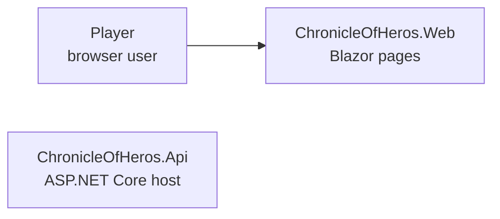

# System: context

Scope: who uses ChronicleOfHeros and which runtime parts and external systems exist today.
Load when: orienting in the system; changing actors, browser entry points, or external dependencies.
Parent: [ARCHITECTURE.md](../../../ARCHITECTURE.md) · Neighbours: [deployment.md](deployment.md), [../solution/projects.md](../solution/projects.md)

- **Player** is a human who uses the browser to manage character data. Accounts and authentication are not currently implemented.
- **Web** is the only host meant for browsers. It renders the Blazor pages and currently makes no API calls.
- **API** currently exposes only the shared Development health endpoints; it has no application authentication or data operations.
- No application database, migrations host, or external service is currently provisioned.
- [Aspire AppHost](deployment.md) orchestrates the runtime parts for local development; no production deployment target is defined.

## Known deviations

- The API no longer implements the ASP.NET Core Identity/JWT design recorded in [ADR 0006](../../adr/0006-identity-backed-jwt-authentication.md). Its replacement remains tracked in #84; until then, there are no protected application endpoints.
- The PostgreSQL datastore selected by [ADR 0002](../../adr/0002-postgresql-as-the-datastore.md) is not currently provisioned; the application has no relational model or migration host yet. Tracking: #84.
