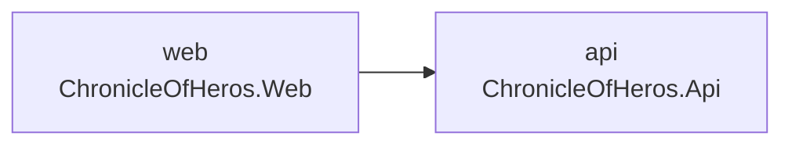

# System: deployment

Scope: the Aspire AppHost resource graph: resources, parameters, references, start order, and health checks.
Load when: changing `src/ChronicleOfHeros.AppHost/AppHost.cs`, adding a resource or parameter, or changing start order or configuration flow between hosts.
Parent: [ARCHITECTURE.md](../../../ARCHITECTURE.md) · Neighbours: [context.md](context.md), [../flows/startup.md](../flows/startup.md), [../cross-cutting/observability.md](../cross-cutting/observability.md)

`ChronicleOfHeros.AppHost` declares the graph in `AppHost.cs`. It has no project references; it adds projects by path with `AddDotnetProject`.

## Resources

<!-- verify: aspire-resources -->
| Resource | Declared by | Parent | Project | References | Waits for | Health check |
|---|---|---|---|---|---|---|
| api | AddDotnetProject | - | ChronicleOfHeros.Api | - | - | http /health |
| web | AddDotnetProject | - | ChronicleOfHeros.Web | api | api | - |

- `WithReference(api)` gives Web a service-discovery entry for `api` over its single `https` endpoint. Web does not use it yet.
- The API and Web launch profiles declare only `https` URLs, so each project resource has a single `https` endpoint and no plain-HTTP endpoint. The API health check polls `/health` on that endpoint.
- Web starts after the API is healthy. The API health check polls `/health`, which exists only in the Development environment ([../cross-cutting/observability.md](../cross-cutting/observability.md)).
- No application database, migration host, explicit parameters, persistent lifetime, or data volumes are declared.

## Parameters

<!-- verify: aspire-parameters -->
| Parameter | Secret | Consumed as |
|---|---|---|
