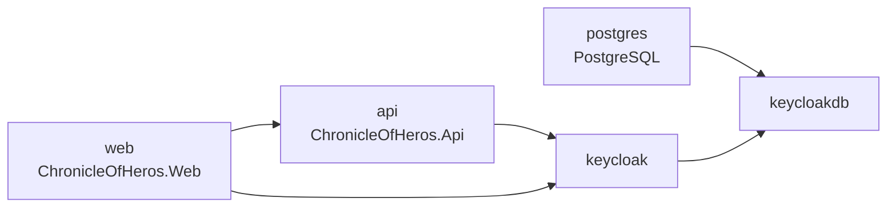

# System: deployment

Scope: the Aspire AppHost resource graph: resources, parameters, references, start order, and health checks.
Load when: changing `src/ChronicleOfHeros.AppHost/AppHost.cs`, adding a resource or parameter, or changing start order or configuration flow between hosts.
Parent: [ARCHITECTURE.md](../../../ARCHITECTURE.md) · Neighbours: [context.md](context.md), [../flows/startup.md](../flows/startup.md), [../cross-cutting/observability.md](../cross-cutting/observability.md)

`ChronicleOfHeros.AppHost` declares the graph in `AppHost.cs`. It has no project references; it adds projects by path with `AddDotnetProject`.



## Resources

<!-- verify: aspire-resources -->
| Resource | Declared by | Parent | Project | References | Waits for | Health check |
|---|---|---|---|---|---|---|
| postgres | AddPostgres | - | - | - | - | - |
| keycloakdb | AddDatabase | postgres | - | - | - | - |
| keycloak | AddKeycloak | - | - | - | - | - |
| api | AddDotnetProject | - | ChronicleOfHeros.Api | keycloak | keycloak | http /health |
| web | AddDotnetProject | - | ChronicleOfHeros.Web | keycloak, api | keycloak, api | http /health |

- `WithReference(api)` gives Web a service-discovery entry for `api` over its single `https` endpoint. Web does not use it yet.
- The API and Web launch profiles declare only `https` URLs, so each project resource has a single `https` endpoint and no plain-HTTP endpoint. Both health checks poll `/health` on that endpoint.
- API waits for Keycloak; Web waits for Keycloak and API health. `/health` exists only in the Development environment ([../cross-cutting/observability.md](../cross-cutting/observability.md)).
- Keycloak uses `keycloakdb` through `WithPostgres` and imports `Keycloak/chronicleofheroes-realm.json` on startup. No application database, migration host, explicit persistent lifetime, or data volume is declared.
- AppHost bind-mounts its `Keycloak/themes/chronicleofheros` directory read-only at `/opt/keycloak/themes/chronicleofheros`. The realm import selects that login theme; it inherits Keycloak's `keycloak` theme and adds local CSS and the product wordmark without replacing templates. Keep the theme directory available on the container host when using this bind-mount configuration outside local development.
- `WEB_PUBLIC_ORIGIN` comes from `web.GetEndpoint("https").PrimaryBrowserOrigin`. This deferred browser-facing origin is not rewritten to a container address and does not require Web to start before Keycloak.

## Parameters

<!-- verify: aspire-parameters -->
| Parameter | Secret | Consumed as |
|---|---|---|
| bootstrap-operator-username | no | keycloak:CHRONICLE_BOOTSTRAP_USERNAME |
| bootstrap-operator-password | yes | keycloak:CHRONICLE_BOOTSTRAP_PASSWORD |

Configure the two parameters through AppHost user secrets or deployment configuration.
For local development:

```powershell
dotnet user-secrets set "Parameters:bootstrap-operator-username" "<username>" --project src\ChronicleOfHeros.AppHost
dotnet user-secrets set "Parameters:bootstrap-operator-password" "<temporary-password>" --project src\ChronicleOfHeros.AppHost
```

The realm import uses native environment placeholders for the login/logout callback
URLs and initial Operator. It is initialization only: Keycloak skips an existing
realm entirely, including changed URLs, users and passwords. Update an existing
realm through Keycloak administration instead of expecting redeployment to apply
the import. Retain PostgreSQL storage separately when data must survive redeployment.

For an existing `chronicleofheroes` realm, select **chronicleofheros** under
**Realm settings > Themes > Login theme** after starting Keycloak with the theme
mount. Do not delete the realm or its database to apply a theme change. The
account console, admin console, and email themes remain unchanged.
