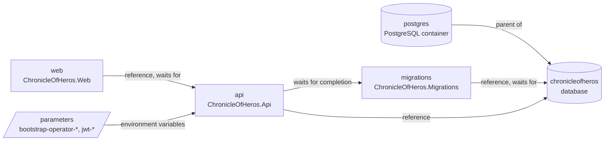

# System: deployment

Scope: the Aspire AppHost resource graph: resources, parameters, references, start order, and health checks.
Load when: changing `src/ChronicleOfHeros.AppHost/AppHost.cs`, adding a resource or parameter, or changing start order or configuration flow between hosts.
Parent: [ARCHITECTURE.md](../../../ARCHITECTURE.md) · Neighbours: [context.md](context.md), [../flows/startup.md](../flows/startup.md), [../cross-cutting/observability.md](../cross-cutting/observability.md)

> Pending approved changes: #75

`ChronicleOfHeros.AppHost` (Aspire AppHost SDK 13.6.4, packages `Aspire.Hosting.Dotnet` and `Aspire.Hosting.PostgreSQL`) declares the graph in `AppHost.cs`. It has no project references; it adds projects by path with `AddDotnetProject`.

## Resources

<!-- verify: aspire-resources -->
| Resource | Declared by | Parent | Project | References | Waits for | Health check |
|---|---|---|---|---|---|---|
| postgres | AddPostgres | - | - | - | - | - |
| chronicleofheros | AddDatabase | postgres | - | - | - | - |
| migrations | AddDotnetProject | - | ChronicleOfHeros.Migrations | chronicleofheros | chronicleofheros | - |
| api | AddDotnetProject | - | ChronicleOfHeros.Api | chronicleofheros | migrations (completion) | http /health |
| web | AddDotnetProject | - | ChronicleOfHeros.Web | api | api | - |

- `WithReference(database)` gives the host the connection string `ConnectionStrings:chronicleofheros`; Identity registration reads it by that name ([../capabilities/identity/persistence.md](../capabilities/identity/persistence.md)).
- `WithReference(api)` gives Web the service-discovery entries for `api`, which the forwarder resolves as `https+http://api` ([../hosts/web.md](../hosts/web.md)).
- The API starts only after the migrations resource has exited successfully; Web starts after the API is healthy. The API health check polls `/health`, which exists only in the Development environment ([../cross-cutting/observability.md](../cross-cutting/observability.md)).
- The PostgreSQL integration adds its own password parameter and health check; they are not declared in `AppHost.cs`.
- No resource declares external HTTP endpoints, persistent lifetime, or data volumes.

## Parameters

<!-- verify: aspire-parameters -->
| Parameter | Secret | Consumed as |
|---|---|---|
| bootstrap-operator-username | no | api:BootstrapOperator__Username |
| bootstrap-operator-temporary-password | yes | api:BootstrapOperator__TemporaryPassword |
| jwt-signing-private-key | yes | api:Jwt__SigningPrivateKey |
| jwt-issuer | no | api:Jwt__Issuer |
| jwt-audience | no | api:Jwt__Audience |

- Values come from AppHost configuration (`Parameters:<name>`, e.g. user secrets; the project has a `UserSecretsId` and no `appsettings` file).
- The API binds them as `BootstrapOperator:*` and `Jwt:*` configuration ([../cross-cutting/security.md](../cross-cutting/security.md)). `jwt-signing-private-key` is a Base64 PKCS#8 RSA private key.
- Only the API receives parameters. Web and Migrations receive none.

## Known deviations

- The API receives an RSA private key parameter; there is no `Jwt:SigningSeed`, no ES256 key derivation, no public key for Web, and no Redis or Data Protection key resource. Deviates from [ADR 0006](../../adr/0006-identity-backed-jwt-authentication.md) and [ADR 0004](../../adr/0004-same-origin-web-api-gateway.md). Tracking: #76.
- Every AppHost start runs the migrations resource before the API. Deviates from [CODING_STANDARDS.md § Registration and composition](../../../CODING_STANDARDS.md#registration-and-composition): distributed-application startup does not run migrations. Tracking: not yet filed.
